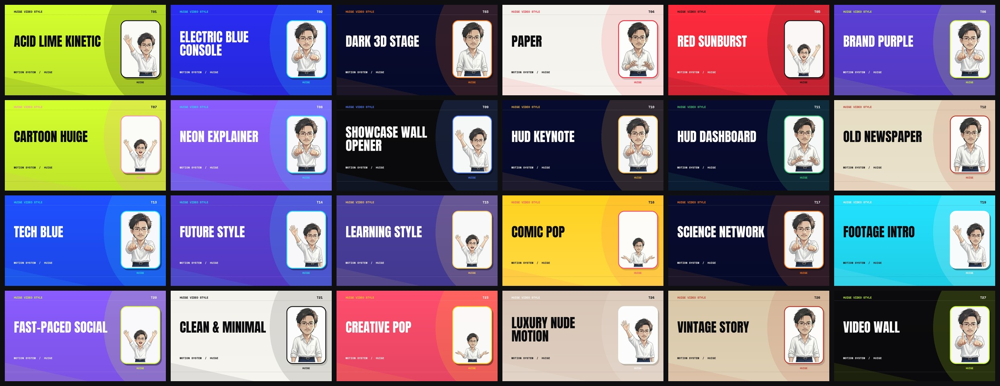
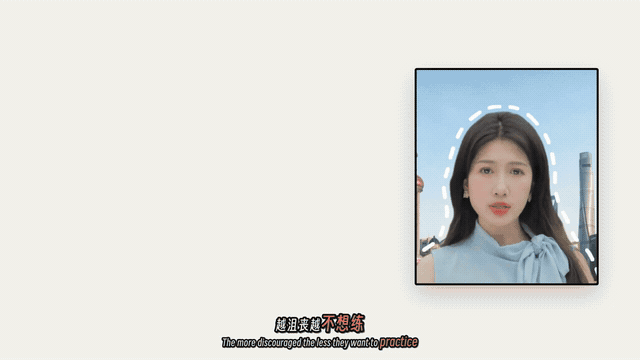
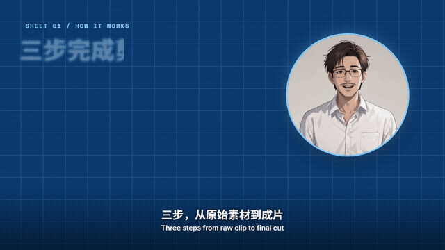
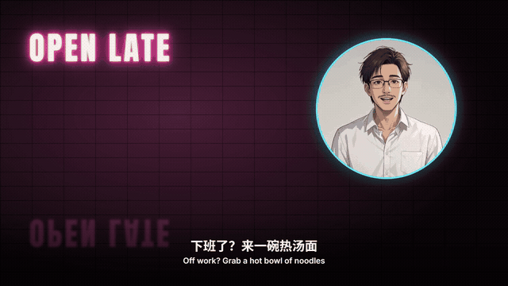
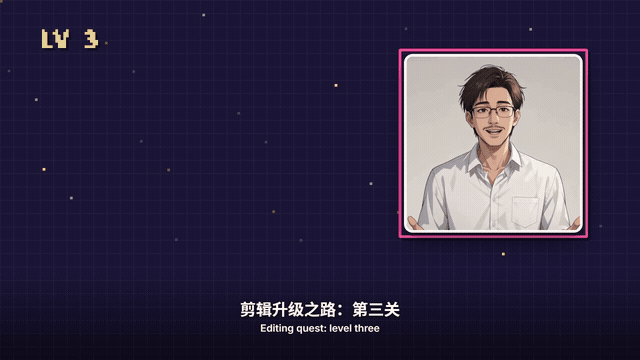
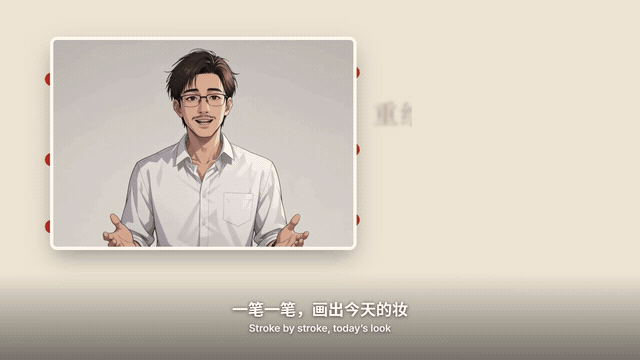
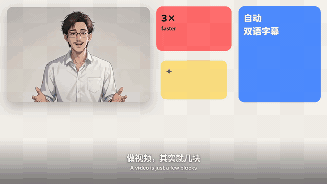
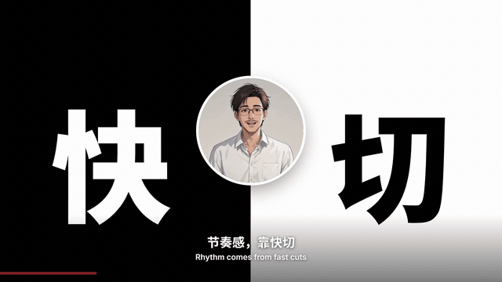

# HUIGE Video Style

**口播视频包装技能 · 剪辑 + 生视频 · 本地渲染 · MIT**

一套给口播内容做视觉包装的技能。它不负责粗剪，负责把已经干净的口播素材变成有视觉系统、有节奏、有中英文字幕的成片；也可以不依赖真人素材，直接用模板生成整屏动态画面。

- 23 套正式模板 + 160 多套概念模板（当前 162 套）
- 横屏 16:9 / 竖屏 9:16
- 人物窗变形、逐词入场、真实录屏、双语字幕
- macOS / Windows / Linux 本地渲染，不需要账号、云端服务或付费 API
- ASR / TTS 不绑定厂商：本地 Whisper、火山 ASR、Fish TTS 等都可以接



## 效果预览

### 实拍口播剪辑

完整版前两段，带中英文字幕：

<table>
<tr>
<td align="center"><br><sub>T159 明暗快切 · 0–10s</sub></td>
<td align="center"><br><sub>T04 纸张 · 10–13.8s</sub></td>
</tr>
</table>

### 概念模板

5 秒无声片段，GIF 循环播放：

<table>
<tr>
<td align="center"><br><sub>T30 Blueprint · 蓝图风</sub></td>
<td align="center"><br><sub>T38 Neon Night · 霓虹夜</sub></td>
</tr>
<tr>
<td align="center"><br><sub>T36 Pixel Game · 像素游戏</sub></td>
<td align="center"><br><sub>T139 Brush Repaint · 笔刷重绘</sub></td>
</tr>
<tr>
<td align="center"><br><sub>T158 Bento · 便当格</sub></td>
<td align="center"><br><sub>T159 Flash Cut · 快切</sub></td>
</tr>
</table>

以上片段均由本技能渲染；完整成片不放进仓库，避免仓库过大。

---

## 目录

- [效果预览](#效果预览)
- [它是什么](#它是什么)
- [两条产品线](#两条产品线)
- [环境依赖](#环境依赖)
- [安装](#安装)
- [快速开始：剪辑包装](#快速开始剪辑包装)
- [快速开始：生视频](#快速开始生视频)
- [自动草稿模式](#自动草稿模式)
- [ASR 与 TTS 接入](#asr-与-tts-接入)
- [模板说明](#模板说明)
- [项目结构](#项目结构)
- [命令速查](#命令速查)
- [质量门禁](#质量门禁)
- [给 AI 助手的执行说明](#给-ai-助手的执行说明)
- [常见问题](#常见问题)
- [许可与第三方](#许可与第三方)

---

## 它是什么

传统剪辑做减法：粗剪、去停顿、去重复、去卡壳、找 B-roll、铺音乐。

HUIGE Video Style 做包装：默认素材已经干净、连续，负责视觉系统、字幕、图形、节奏和转场。

标准流程是：

```text
原始口播 → 先粗剪干净 → 再用本技能包装 → 渲染 → 合字幕/音效 → 质检 → 成片
```

原片里的卡壳、重复、长停顿，本技能不会替你修。

它属于**视频包装类技能**，不是传统剪辑技能。它也不是某一个固定模板，而是一套模板系统：每套模板有自己的色彩、字体、版式、动效、人物窗和组件词汇。

## 两条产品线

| | 剪辑包装 | 生视频 |
|---|---|---|
| 主体 | 人物与表演 | 脚本与图形 |
| 素材 | 必须有原始口播或演示 | 声音 + 时间文本即可；人物可占位、卡通或无人物 |
| 模板作用 | 字幕、节奏、图形叠加 | 整屏画面由模板生成 |
| 人物占比 | 应较高：全幅 / 中近景为主 | 可以小窗、角落，甚至无人物 |
| 典型模板 | `template/demo/`、`template/examples/` | `template/concepts/` |
| 输出 | 人物主导的口播成片 | 代码类视频、动态排版、HUD、霓虹、漫画、极简、像素、复古拼贴 |

同一个引擎、同一套模板资产，可以长出两条线。但两类模板不能互相替代：

- 剪辑型模板继续加，只会让剪辑更强。
- 生视频需要的是带内容槽位、章节结构、能编排长叙事的模板。

两种画幅都支持：横屏 16:9（1920×1080）和竖屏 9:16（1080×1920）。同一套模板会按画幅重新排版，不是简单裁切。

---

## 环境依赖

### 必需

| 组件 | 要求 | 检查命令 |
|---|---|---|
| Node.js | 20+（最低 18+） | `node -v` |
| npm | 随 Node 安装 | `npm -v` |
| Python | 3.10–3.13，**不要 3.14** | `python --version` |
| FFmpeg | 必须带 `libx264` 和 `libass` / `subtitles` | `ffmpeg -version` |
| Chromium | Playwright 自带，或系统 Chrome | `npx playwright --version` |
| Git | 下载仓库；Windows 需要 Git Bash | `git --version` |
| 磁盘 | 仓库约 100 MB，另留素材和渲染空间 | — |

FFmpeg 的 libass 检查：

```bash
ffmpeg -hide_banner -filters | grep -E ' ass | subtitles '
```

Windows 用：

```bat
ffmpeg -hide_banner -filters | findstr ass
```

### 字体

引擎自带（SIL OFL 1.1）：

- Anton
- Archivo Black
- Playfair Display
- Space Mono

需要系统安装：

- **Smiley Sans Oblique / 得意黑**：烧录中英文字幕
- **Inter**：英文界面字体
- **Noto Sans CJK SC**：中文显示，建议装 Regular、Bold、Black
- **Noto Color Emoji**：可选，Windows 可用 Segoe UI Emoji 兜底

Windows 的 libass 走 DirectWrite，字体必须**安装到系统**，只放在文件夹里不够。

### 可选

| 组件 | 用途 |
|---|---|
| 本地 Whisper（openai-whisper / faster-whisper） | 生成带词级时间的 JSON |
| 火山 ASR | 生成 `utterances[]` + `words[]` 的 JSON |
| Fish TTS / 其他 TTS | 生成配音音轨 |
| 系统 Chrome | 替代 Playwright Chromium 渲染 |
| NVIDIA GPU | 可选；CPU 也能跑，只是慢 |

ASR 和 TTS **不随技能安装**。技能只消费最终的 SRT、transcript JSON 或音频文件。

---

## 安装

### 1. 下载

```bash
git clone https://github.com/huige-opc/huige-video-style.git
cd huige-video-style
```

也可以在 GitHub 页面点 **Code → Download ZIP**，解压后进入目录。

### 2. Node 依赖

```bash
npm ci
npx playwright install chromium
```

如果已经有系统 Chrome，可以跳过 Playwright 下载，渲染时传 `--browser`：

```bash
node scripts/render.mjs template/section/index.html \
  --stills check \
  --times 0.8,2.5,5 \
  --browser "C:/Program Files/Google/Chrome/Application/chrome.exe"
```

### 3. Python 依赖

手动分镜、概念模板、抠像所需：

```bash
# Windows
py -3.12 -m venv .venv
.venv\Scripts\python.exe -m pip install -r requirements.txt

# macOS / Linux
python3 -m venv .venv
.venv/bin/pip install -r requirements.txt
```

`requirements.txt` 包含：numpy、opencv-python-headless、onnxruntime、jieba。

- `onnxruntime` 只有 T19 / T24 / T26 的人物抠像需要；模型首次运行时单独下载，不随仓库分发。
- `jieba` 只有字幕关键词提取需要；缺失时 `captions.py` 会自动降级。

使用 Python 脚本前先激活虚拟环境：

```bash
# Windows
.venv\Scripts\activate

# macOS / Linux
source .venv/bin/activate
```

或者把命令里的 `python` 换成 `.venv\Scripts\python.exe` / `.venv/bin/python`。

### 4. HUIGE-Core（可选，自动草稿）

只有想跑自动草稿流水线时才需要：

```bash
cd HUIGE-Core

# Windows
py -3.12 -m venv .venv
.venv\Scripts\python.exe -m pip install -r requirements-core.txt
npm ci

# macOS / Linux
python3 -m venv .venv
.venv/bin/pip install -r requirements-core.txt
npm ci
```

### 5. 校验文件

```bash
sha256sum -c HUIGE-Core/checksums.sha256

for c in templates/*/*/checksums.sha256; do
  sha256sum -c "$c"
done
```

全部显示 `OK` 才算安装完整。Windows 没有 `sha256sum` 时，用 Git Bash 或 PowerShell 的 `Get-FileHash` 代替。

### 6. 跑一个最小示例

```bash
npm run example
```

会在 `check/` 下生成三张静帧。能出图，说明 Node、Playwright/Chrome、引擎都通了。

---

## 快速开始：剪辑包装

正式交付走**逐段分镜**：每段 3–10 秒，单独写 `scenes.js`，渲染后拼接。自动适配器只出草稿，不能直接交付。

### 1. 建项目目录

不要覆盖技能里的模板和示例。每个项目新建版本目录：

```text
myproject/v1/
  engine/                 ← 复制仓库 engine/
  media/huige/            ← 口播人物帧 f_00000.jpg ...
  media/screen/           ← 真实录屏帧（可选）
  s1/ s2/ ...             ← 每段一个目录
  srt/                    ← 用户的 SRT + display_fix.json
  sec/                    ← 分段渲染和音效
  out/                    ← 最终成片
```

```bash
mkdir -p myproject/v1/media/huige
cp -r engine myproject/v1/engine
cp -r template/section myproject/v1/s1
```

复制后把 `myproject/v1/s1/index.html` 里的 `../../engine/` 改成 `../engine/`。

### 2. 抽人物帧

```bash
scripts/extract_frames.sh raw/talk.mp4 myproject/v1/media/huige
```

输出固定 30 fps、按绝对帧号命名的 JPG：`f_00000.jpg`、`f_00001.jpg`……

不要改帧率，不要重新编号。最终视频帧数必须等于源视频帧数。

### 3. 校准人脸

在 `scenes.js` 里设置：

```js
C.face = { x: .54, y: .35, h: .5 };
```

- `x`：脸中心在画面宽度中的比例
- `y`：头部中心在画面高度中的比例
- `h`：从发顶到下巴的头部高度占画面高度的比例

先用 3–4 个不同时间点渲染静帧检查，确保最小圆形窗口和最大卡片窗口里，人物**从头发到下巴都完整可见**。每次换机位都要重新校准。

### 4. 写分镜

复制 `template/section/` 后，编辑 `scenes.js`：

```js
C.src0 = 0;                    // 这一段从源视频第几秒开始
C.end = 6;                     // 这一段多长
C.huigeDir = '../media/huige'; // 人物帧目录
C.face = { x: .54, y: .35, h: .5 };
C.huigeKeys = [ /* 人物窗路径 */ ];
```

详细 API 见 [`references/engine-api.md`](references/engine-api.md)，完整生产流程见 [`references/pipeline.md`](references/pipeline.md)。

### 5. 静帧 + 布局门禁

```bash
node scripts/render.mjs myproject/v1/s1/index.html \
  --stills myproject/v1/check/s1 \
  --times 1.2,3.5,6

node scripts/check_layout.mjs myproject/v1/s1/index.html \
  --times 1.2,3.5,6
```

`check_layout.mjs` 必须输出 `LAYOUT OK`。它会检查：

- 文字压文字
- 文字压在人物窗上
- 文字出画
- 大面积空白（WARN，人工看一眼）

静帧也要自己看：文字有没有被人物挡住、卡片有没有互相压、录屏有没有被裁掉、说话时画面是不是空的。

### 6. 渲染分段

```bash
node scripts/render.mjs myproject/v1/s1/index.html \
  --out myproject/v1/sec/s1.mp4

node scripts/render.mjs myproject/v1/s1/index.html \
  --cues myproject/v1/sec/s1_cues.json
```

`render.mjs` 默认 30 fps、1920×1080；竖屏加 `--ar 9:16`。

它不会覆盖已存在的输出。要重渲染，换文件名或换版本目录。

### 7. 字幕

准备一个中英双语 SRT：中文 cue 和英文 cue 对同一段话，时间可以略有差异。

```bash
python scripts/captions.py \
  myproject/v1/srt/talk.srt 0 99999 \
  myproject/v1/out/NAME \
  myproject/v1/srt/display_fix.json
```

输出：

- `NAME.srt`：可编辑的双语字幕
- `NAME.ass`：烧录用样式字幕

`display_fix.json` 可选，用来修明显错别字或机翻错误；只改烧录字幕，不改原始 SRT。格式：

```json
{
  "fix": {
    "原始中文行": "显示用的中文行",
    "EN:原始中文行": "补上的英文行"
  },
  "keys": ["需要高亮的关键词"]
}
```

### 8. 音效与合成

```bash
python scripts/merge_cues.py \
  myproject/v1/sec/all_cues.json \
  myproject/v1/sec/s1_cues.json:0 \
  myproject/v1/sec/s2_cues.json:12.4

python scripts/sfx.py \
  myproject/v1/sec/all_cues.json 60 \
  myproject/v1/sec/sfx.wav

scripts/assemble.sh \
  raw/talk.mp4 \
  myproject/v1/sec/sfx.wav \
  myproject/v1/out/NAME.ass \
  myproject/v1/out/NAME \
  myproject/v1/sec/s1.mp4 \
  myproject/v1/sec/s2.mp4
```

`assemble.sh` 会：

1. 按顺序拼接分段
2. 提取原始人声音轨
3. 混入短音效，响度归一到约 -16 LUFS
4. 输出 `NAME_Clean.mp4`（无字幕）和 `NAME_CN-EN.mp4`（烧录双语字幕）

它**不会自动铺背景音乐**。需要 BGM 时，在最终混音后单独叠加，并把音乐压在人声下面。

### 9. 检查交付

```bash
scripts/contact_sheet.sh myproject/v1/out/NAME_CN-EN.mp4 \
  myproject/v1/out/sheet.jpg 5
```

检查：

- 最终帧数等于源视频帧数
- 全片能正常解码
- 响度约 -16 LUFS
- 联系表上没有文字压脸、出框、字幕和图形打架
- 相邻两段的接缝处，人物窗位置一致，看不出跳变

---

## 快速开始：生视频

不需要真人素材。准备一套讲解员帧，或直接用无人物 / 纯文字概念模板。

### 1. 准备讲解员帧

如果已经用视频模型生成了讲解员视频：

```bash
scripts/extract_frames.sh presenter.mp4 media/presenter 1280
```

得到 `media/presenter/f_00000.jpg ...`。帧率仍是 30 fps。

如果用的是卡通人物或占位图，也按同样方式做成 30 fps 序列。

### 2. 渲染概念模板

```bash
node scripts/render.mjs template/concepts/t30/index.html \
  --out out/t30.mp4 \
  --query "huige=/absolute/path/media/presenter&srcw=1280&srch=720&face=.5,.26,.42" \
  --browser "C:/Program Files/Google/Chrome/Application/chrome.exe"
```

参数说明：

| 参数 | 含义 |
|---|---|
| `huige` | 人物帧目录，绝对路径；Windows 用 `file:///D:/...` 或 `/D:/...` 形式 |
| `srcw` / `srch` | 人物帧的宽高，必须和实际帧一致 |
| `face` | `x,y,h`，人脸标定，含义同剪辑线 |
| `--ar 9:16` | 竖屏输出 1080×1920 |
| `--from` / `--to` | 只渲染某一段，单位秒 |

### 3. 多段拼接

概念模板默认是 10 秒三场景。做长视频时：

1. 复制 `template/concepts/tNNN`，按主题拆成 N 秒段落。
2. 按 [`references/concept-sections.md`](references/concept-sections.md) 改 `M.TB`、`M.story`、`C.src0`、`C.end`、`C.huigeKeys`。
3. 每段单独渲染，再用 ffmpeg concat 拼接。

不要让同一套模板从头套到尾。一个 3 分钟的视频，建议 3–5 套兼容模板轮换，否则看起来像模板演示，不像成片。

### 4. 不需要人物时

部分概念模板是纯 Logo / 文字型，不需要讲解员帧。ID 范围：`t83–t94`、`t96–t100`。它们适合做片头、章节卡、结尾卡，不是完整叙事模板。

---

## 自动草稿模式

`HUIGE-Core` 是自动适配器，只出草稿，**不能直接交付**。它必须显式加 `--allow-draft` 才会运行。

```bash
cd HUIGE-Core

# Windows
.venv\Scripts\python.exe core\pipeline.py edit ..\raw\talk.mp4 jobs\t01 ^
  --install-root .. --templates T01 --aspect 16:9 --srt ..\raw\talk.srt --allow-draft

# macOS / Linux
.venv/bin/python core/pipeline.py edit ../raw/talk.mp4 jobs/t01 \
  --install-root .. --templates T01 --aspect 16:9 \
  --srt ../raw/talk.srt --allow-draft
```

多模板：

```bash
.venv/bin/python core/pipeline.py edit ../raw/talk.mp4 jobs/mix \
  --install-root .. --templates T01,T13,T17,T23,T05 --mode multi \
  --aspect 16:9 --srt ../raw/talk.srt --allow-draft
```

输出在 `jobs/<name>/out/`：`preview.mp4`、`final.mp4`、`captions.srt`、QA 报告。失败时看 `out/failure.json` 和 `logs/`。

再次强调：草稿模式只是快速看节奏和风格，正式交付必须走逐段分镜。

---

## ASR 与 TTS 接入

技能不安装、不运行 ASR/TTS。你只需要把结果以 SRT 或 JSON 交给它。

### 方式一：直接给 SRT

任何 ASR 工具导出的 SRT 都可以：

```bash
python HUIGE-Core/core/pipeline.py edit raw/talk.mp4 jobs/v1 \
  --install-root . --templates T01 --aspect 16:9 \
  --srt raw/talk.srt --allow-draft
```

手动分镜流程直接用 `scripts/captions.py` 读 SRT。

### 方式二：本地 Whisper

```bash
pip install openai-whisper

whisper raw/talk.mp4 \
  --model small \
  --language zh \
  --output_format json \
  --output_dir asr
```

然后把 `asr/talk.json` 传给 Core：

```bash
python HUIGE-Core/core/pipeline.py edit raw/talk.mp4 jobs/v1 \
  --install-root . --templates T01 --aspect 16:9 \
  --transcript-json asr/talk.json --allow-draft
```

也可以先转换成统一格式：

```bash
python HUIGE-Core/scripts/import_transcript.py asr/talk.json asr/talk
```

输出：

- `talk.asr.json`
- `talk.transcript.js`
- `talk.bilingual.srt`
- `talk.en.srt`（输入里有英文块时）

### 方式三：火山 ASR

用你已有的火山转写工具生成 `utterances[]` + `words[]` 的 JSON，然后：

```bash
python HUIGE-Core/core/pipeline.py edit raw/talk.mp4 jobs/v1 \
  --install-root . --templates T01 --aspect 16:9 \
  --transcript-json asr/volc.json --allow-draft
```

### 支持的 JSON 格式

`import_transcript.py` 会自动识别：

- 本地 Whisper：`{"segments": [{"start","end","text","words":[...]}]}`
- 火山：`{"utterances": [{"start_time","end_time","text","words":[...]}]}`（秒）
- Fish / talkcraft：`{"sentences": [{"start","end","text","words":[...]}]}`
- 通用：`{"source": {"language", "segments":[...]}}` 或直接 `{"segments":[...]}`

### TTS

配音用 Fish 或其他引擎单独生成，导出 WAV / MP3。技能只消费最终音频：

- 剪辑线：如果沿用原视频人声，`assemble.sh` 会直接从源视频提取。
- 如果换成 TTS 配音：先用 ffmpeg 把 TTS 音轨和无声成片合成，再做字幕和响度检查。
- 生视频线：TTS 音轨直接和渲染好的无声视频合成。

技能不绑定厂商，也不会替你申请 API Key。

---

## 密钥安全

仓库里不包含任何 API Key、云服务密钥或账号密码。

如果你接入 DeepSeek、火山、Fish、OpenAI 等服务：

- 密钥只放在本机环境变量或本地 `.env` 文件里。
- `.env`、`.env.*`、`*.pem`、`*.key`、`secrets/` 已在 `.gitignore` 中排除。
- 不要把密钥写进 `scenes.js`、模板、README、示例配置或截图。
- 分享项目前先跑 `git status`，确认没有把本地配置带进去。
- 如果不小心提交了密钥，先撤销并在服务商后台轮换，再清理 git 历史。

## 模板说明

### 23 套正式模板

| ID | 模板 | 适合 |
|---|---|---|
| T01 | 酸性青柠 Acid Lime Kinetic | 开场、钩子、强观点、胜利感 |
| T02 | 电光蓝控制台 Electric Blue Console | 数字、结果、对比 |
| T03 | 暗黑 3D 舞台 Dark 3D Stage | 真实录屏、产品演示 |
| T04 | 纸张 Paper | 痛点、平静解释 |
| T05 | 红色放射 Red Sunburst | 重点、行动号召、结尾 |
| T06 | 品牌紫 Brand Purple | 产品发布 |
| T07 | 卡通 Huige Cartoon Huige | 故事、卡通素材 |
| T09 | 作品墙开场 Showcase Wall Opener | 频道开场、系列片头、发布 |
| T10 | HUD 发布会 HUD Keynote | 公告、里程碑 |
| T11 | HUD 仪表盘 HUD Dashboard | 教程、工作流、功能、迭代 |
| T12 | 旧报纸 Old Newspaper | 故事、回顾、观点、批评 |
| T13 | 科技蓝 Tech Blue | 科技、AI、产品、议程、对比 |
| T14 | 未来科技 Future Style | 大新闻、规则、AI、未来、结尾 |
| T15 | 学习风 Learning Style | 教育、学习方法、词汇、亲子内容 |
| T16 | 漫画风 Comic Pop | 轻松讲解、前后对比、要点、清单 |
| T17 | 科学风 Science Network | 科技趋势、科学、学习原理、未来 |
| T19 | 真实影像引入 Footage Intro | 真实素材、新闻片段、录屏 |
| T20 | 快节奏社媒 Fast-Paced Social Media | 抖音 / 视频号 / Reels 节奏 |
| T21 | 简洁极简 Clean & Minimal | 教程、商业分析、教育 |
| T23 | 创意波普 Creative Pop | 轻松教程、步骤、工作流、创作者技巧 |
| T24 | 奢华裸色 Luxury Nude Motion | 高端个人品牌、框架、步骤、产品介绍 |
| T26 | 复古拼贴故事 Vintage Story | **仅 9:16**，复古拼贴叙事 |
| T27 | 视频墙动态排版 Video Wall Kinetic Typography | 片头、作品墙、快速切换 |

T08、T25、T28 不包含；T18、T22 已退役，ID 不再复用。

### 160 多套概念模板（当前 162 套）

`template/concepts/` 下有 T30–T200 的概念模板，每套是 10 秒三场景、无声、带示例字幕和真实转场。它们适合：

- 快速看风格
- 复制成 N 秒段落
- 做生视频的起点

概念模板里的文案和数字都是示例，交付前必须替换。

### 两棵树：`template/` 和 `templates/`

| | `template/`（单数） | `templates/`（复数） |
|---|---|---|
| 给谁 | 人：学习、复制、改 | 机器：HUIGE-Core Registry |
| 内容 | 真正的 `index.html` + `scenes.js` | 元数据 + 自动适配器 + 打包 runtime |
| 能否直接出片 | 能，满血 | 只借窗口、配色、版式，草稿级 |
| 能否改 | 能，就是源码 | 不建议改，校验和版本会不一致 |

小写 `template/` 是源码，大写 `templates/` 是安装包。两者不是同一份文件。

---

## 项目结构

```text
huige-video-style/
├── SKILL.md                  Claude 技能入口
├── README.md                 本文件
├── LICENSE                   MIT
├── package.json              Node 依赖与示例命令
├── requirements.txt          手动分镜 / 概念模板 Python 依赖
├── engine/                   引擎：场景、人物窗、字幕、渲染
├── scripts/                  抽帧、渲染、布局门禁、字幕、音效、合成、抠像
├── template/                 人手写的源码与示例
│   ├── section/              空白分镜骨架
│   ├── demo/                 T01–T23 同题横评
│   ├── sample5/              T24 / T26 / T27 短样片
│   ├── concepts/             T30–T200 概念模板
│   └── examples/             已验收的实战段落
├── templates/                23 套机器安装包 T01–T27
├── HUIGE-Core/               自动草稿流水线
├── references/               API、流程、风格、模板卡
├── assets/                   Huige 动作帧
└── docs/                     模板拼图、仓库说明
```

---

## 命令速查

### 抽帧

```bash
scripts/extract_frames.sh INPUT.mp4 OUT_DIR [WIDTH]
```

### 渲染

```bash
node scripts/render.mjs SECTION/index.html --out out/s1.mp4
node scripts/render.mjs SECTION/index.html --stills check/s1 --times 1,3.5,6
node scripts/render.mjs SECTION/index.html --cues out/s1_cues.json
```

常用参数：

| 参数 | 默认 | 说明 |
|---|---|---|
| `--fps` | 30 | 帧率，不要改 |
| `--ar` | 16:9 | 16:9 或 9:16 |
| `--from` / `--to` | 全段 | 只渲染一部分，单位秒 |
| `--crf` | 16 | H.264 质量 |
| `--browser` | 环境变量 `CHROME` | 指定 Chrome/Chromium |
| `--query` | 空 | URL 查询参数，如 `huige=...&face=...` |

### 布局门禁

```bash
node scripts/check_layout.mjs SECTION/index.html --times 1,3.5,6
```

必须输出 `LAYOUT OK`。

### 字幕

```bash
python scripts/captions.py SRC.srt START END OUT_BASENAME [config.json]
```

### 音效

```bash
python scripts/merge_cues.py out/all_cues.json sec/s1_cues.json:0 sec/s2_cues.json:12.4
python scripts/sfx.py out/all_cues.json 60 sec/sfx.wav
```

### 合成

```bash
scripts/assemble.sh SOURCE_VIDEO SFX.wav CAPTIONS.ass OUT_BASENAME section1.mp4 section2.mp4 ...
```

### 联系表

```bash
scripts/contact_sheet.sh OUT.mp4 OUT.jpg 5
```

### 抠像

```bash
python scripts/matte.py FRAMES_DIR FIRST LAST OUT_DIR [--ratio 0.25]
```

用于 T19 / T24 / T26。首次运行会下载 GPL-3.0 的 RVM 模型到 `~/.cache/huige-video-style/`，不随仓库分发。

---

## 质量门禁

交付前逐条过：

1. **画幅和帧率**：1920×1080 或 1080×1920，30 fps，全片无水印、无时间码、无章节条。
2. **人物完整**：从头发到下巴始终可见，任何窗口形状都不能裁脸。
3. **文字安全**：文字不压脸、不出框、不互相重叠；`check_layout.mjs` 输出 `LAYOUT OK`。
4. **素材真实**：软件界面必须来自真实录屏；概念性画面标 `ILLUSTRATIVE`；不伪造数字、价格、日期。
5. **字幕**：中英双语，中文在上、英文在下；只改烧录字幕，不改原始 SRT。
6. **音频**：保留原始人声；短音效可用；自动混音不铺 BGM；需要 BGM 时后期单独加并压在人声下；响度约 -16 LUFS。
7. **接缝**：相邻两段的人物窗首尾姿态一致，拼接不跳。
8. **帧数**：最终帧数等于源视频帧数。
9. **动效质量**：禁止整卡上下浮动、呼吸、抖动、随机漂浮等廉价动效；持续动效必须由内容驱动（扫描线、光扫、路径绘制、计数、镜头推进、按节拍闪切）。静态好过装饰性运动。参考 `projects/20261122_HUIGE风格基线/out/FULL117_CN-EN.mp4`。
10. **冲击力下限**：每 3–5 秒必须有一个视觉事件（硬切、全屏换色、大字位移、镜头推进或新元素组）；同一张静态卡不要连续停留超过约 2 秒。
11. **快切帧规则**：小于 1.2 秒的镜头视为 cut frame，画面元素直接以最终状态出现，不做入场、持续动效或人物窗滑动；`check_layout.mjs` 会输出 `MOTION OK/FAIL`，失败一票否决。
12. **文字换场规则**：文字到文字的换场用 `tr: ['cut','cut']`，该边界的人物窗 key 必须 `d: 0`；禁止用 `zoom` / `blur` 交叉淡化文字，也不许人物窗滑动跨过切点，否则会残留上一秒画面。

---

## 给 AI 助手的执行说明

把下面这段直接发给 Claude Code、Codex 或其他编程助手：

```text
请阅读这个仓库的 README.md，按“安装”章节帮我配置环境。

要求：
1. 先运行 node -v、npm -v、python --version、ffmpeg -version，把结果告诉我。
2. 缺什么依赖就列出来，不要自己安装 ASR/TTS，也不要用 npx skills add 或 git clone 第三方包。
3. 安装 Node 依赖、Python 依赖和 Chromium 后，运行 npm run example 验证。
4. 验证通过后，帮我用 template/section 跑一个 6 秒测试段：
   - 抽帧到 media/huige
   - 校准 face
   - 写 scenes.js
   - 先渲染 stills，再跑 check_layout.mjs
   - 最后渲染 mp4
5. 每一步把命令和结果发给我，失败了先解释原因，不要连续盲试。
6. 不要覆盖已有文件；所有输出放到新的版本目录。
```

AI 执行时必须遵守：

- 先读 `SKILL.md`、`references/pipeline.md`、`references/engine-api.md`，再动手。
- 先问清楚：素材路径、画幅、模板偏好、是否有字幕 / ASR 结果。
- 写完 `scenes.js` 先跑静帧和 `check_layout.mjs`，通过后再渲染。
- 不交付 `--allow-draft` 的草稿。
- 不把 `node_modules/`、`.venv/`、`media/`、`jobs/`、`out/` 提交到仓库。
- 不伪造数据、不编软件界面、不裁人物脸。

---

## 常见问题

### 人物窗是黑的 / 空的

检查 `C.huigeDir` 是否相对于当前 section 目录正确，以及帧名是否是 `f_00000.jpg` 连续编号。概念模板检查 `--query huige=` 路径和 `srcw/srch` 是否匹配。

### 字体回退成默认字体

- 确认系统装了得意黑、Inter、Noto Sans CJK SC。
- `assemble.sh` 可用 `FONTSDIR` 指定字体目录。
- Windows 的 libass 走 DirectWrite，字体必须安装到系统。

### FFmpeg 报没有 ass / subtitles 滤镜

当前 FFmpeg 是精简版。换带 libass 的完整构建；macOS 可用 Homebrew 的 `ffmpeg-full`，并把它的 `bin` 加进 `PATH`。

### 渲染报 Chrome / Chromium 启动失败

用系统 Chrome：

```bash
--browser "C:/Program Files/Google/Chrome/Application/chrome.exe"
```

或设置环境变量 `CHROME`。

### Python 3.14 装不上 numpy

用 Python 3.12 建虚拟环境。`numpy==2.0.2` 没有 3.14 的轮子。

### 输出文件已存在

`render.mjs`、`extract_frames.sh`、`assemble.sh` 都不会覆盖已有文件。换文件名或换版本目录。

### 字幕和人物打架

先跑 `check_layout.mjs`，再亲眼看静帧。字幕区域不要放关键图形；人物窗路径要避开字幕带。

### 自动草稿看起来像模板演示

正常。自动适配器只借窗口、配色、版式，不跑模板的手写场景。正式交付用逐段分镜。

---

## 许可与第三方

- 本仓库代码与模板：**MIT License © 2026 huige-opc**，见 [`LICENSE`](LICENSE)。
- 引擎自带字体：SIL Open Font License 1.1，许可证文本在 `engine/fonts/licenses/`。
- RVM 抠像模型：GPL-3.0，首次运行时单独下载，不随仓库分发。
- 用户素材、录屏、配音、音乐：版权归用户或原始权利人，仓库不包含任何用户媒体。

---

## 版本

- 当前版本：1.0.1
- 仓库：https://github.com/huige-opc/huige-video-style
- 本地优先，不需要账号、云端服务或付费 API。
